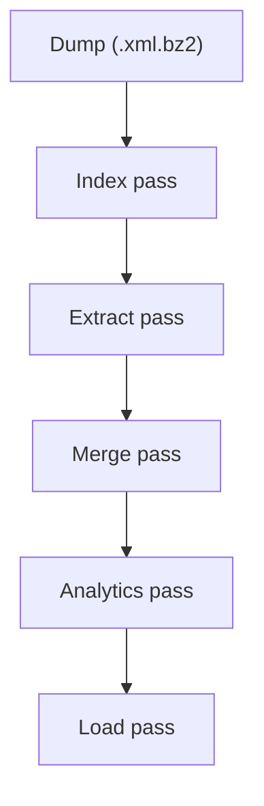

# Dedalus Architecture

Dedalus reads a compressed Wikipedia XML dump and produces CSV files describing the link graph, one JSON blob per article, an `analytics.csv` of PageRank, community and degree per article, and a DuckDB database file holding all of it.
The CSVs are the hand-off between passes; the DuckDB file is a copy of them for querying.
`dedalus pipeline` runs every pass in order; each pass is also its own subcommand.

## The Passes

**Index** (`src/index.rs`) reads every page without its text and builds `WikiIndex`: a map from normalized title to page id, and a redirect table.
Lookups follow redirect chains up to `REDIRECT_MAX_DEPTH` hops.
The index is cached as `index.cache` in the output directory, keyed on the dump's size and modification time and on `CACHE_VERSION`.

**Extract** (`src/extract.rs`) reads every article again, with text, and writes rows through `ShardedCsvWriter`, which assigns each page to shard `page_id % csv_shards`.
Wikitext is mined by `src/content.rs` (links, categories, images, external links, abstract, sections) and `src/infobox.rs` (the first infobox).
Link targets are resolved through the index; a link inside the article's "See also" section becomes a SEE_ALSO edge and any other link a LINKS_TO edge.
The dump is read in ordered chunks of `--checkpoint-interval` pages; each chunk's pages are processed in parallel, and reading the next chunk overlaps with processing the current one.
After every chunk all writers are flushed and `checkpoint.bin` is saved with the run's identity (dump path, size and mtime, output directory, shard counts, reading mode), where reading stopped (pages read for a standard dump, streams read for a multistream one), and the byte length of every CSV.
`--resume` truncates each CSV back to its recorded length and continues from the next chunk, so an interrupted run ends with the same output as an uninterrupted one.
A checkpoint whose identity does not match the current run is ignored, and a completed run removes it.
A fresh run first removes CSVs an earlier run left behind that it will not overwrite, including an old `analytics.csv`.

**Merge** (`src/merge.rs`) joins `nodes_000.csv`, `nodes_001.csv` and the rest into `nodes.csv`, for each CSV type, deduplicating category, image and external link nodes across shards.
Each merged file is written to a `.tmp` sibling and renamed into place.
With `--archive` the shard files move to `shards/`, replacing any shards archived earlier.

**Analytics** (`src/analytics.rs`) builds a compressed sparse row graph from the LINKS_TO edges of the merged CSVs and computes PageRank, label propagation communities and in plus out degree.
SEE_ALSO edges are left out, as are edges whose endpoints are not in `nodes.csv`.
Results go to `analytics.csv`, one row per article.

**Load** (`src/load.rs`) copies each merged CSV into one table of `wikipedia.duckdb` with DuckDB's `read_csv` and explicit column types: `articles`, `links` (with its `type` column, LINKS_TO or SEE_ALSO), `categories`, `article_categories`, `images`, `article_images`, `external_links`, `article_external_links`, and `analytics` when `analytics.csv` exists.
The database is built as a `.tmp` file and renamed into place, so a failed load keeps the previous database.
`load` refuses to replace an existing database without `--clean`; `pipeline` always replaces it, since it has just rewritten the CSVs.
Locally the build links Homebrew's `libduckdb` (set in `.cargo/config.toml`); CI downloads DuckDB's prebuilt Linux library and points the build at it with environment variables.

## Two Ways to Read the Dump

A standard dump is one bz2 stream, decompressed sequentially by `WikiReader` in `src/parser.rs` (through `lbzip2` or `pbzip2` when either is on `PATH`).
A multistream dump is many independent bz2 streams plus an index file of their byte offsets.
`src/multistream.rs` reads that index and lets each rayon worker seek to, decompress and parse its own stream, so both passes run on every core.
The index file is found from the dump's name (`*-multistream.xml.bz2` beside `*-multistream-index.txt.bz2`) or given with `--multistream-index`.

## On-Disk Output

| Path | Contents |
|---|---|
| `nodes.csv` | One row per article: `id:ID`, `title`, `:LABEL` |
| `edges.csv` | `:START_ID`, `:END_ID`, `:TYPE` (LINKS_TO or SEE_ALSO) |
| `categories.csv`, `article_categories.csv` | Category nodes and HAS_CATEGORY rows |
| `image_nodes.csv`, `article_images.csv` | Image nodes and HAS_IMAGE rows |
| `external_link_nodes.csv`, `article_external_links.csv` | External link nodes and HAS_LINK rows |
| `analytics.csv` | `id:ID`, `pagerank:double`, `community:long`, `degree:int`; the community is named by the page id of one of its articles |
| `wikipedia.duckdb` | The DuckDB database, one table per CSV |
| `blobs/NNN/<id>.json` | Article content: abstract, sections, infobox, categories |
| `index.cache` | The cached title index |
| `checkpoint.bin` | Resume state, removed when a run completes |
| `shards/` | Archived shard CSVs, after `merge-csvs --archive` |

The CSV headers use neo4j-admin's typed-column style (`id:ID`, `:START_ID`).
Nothing imports them into Neo4j any longer; the style is kept because it is self-describing.
